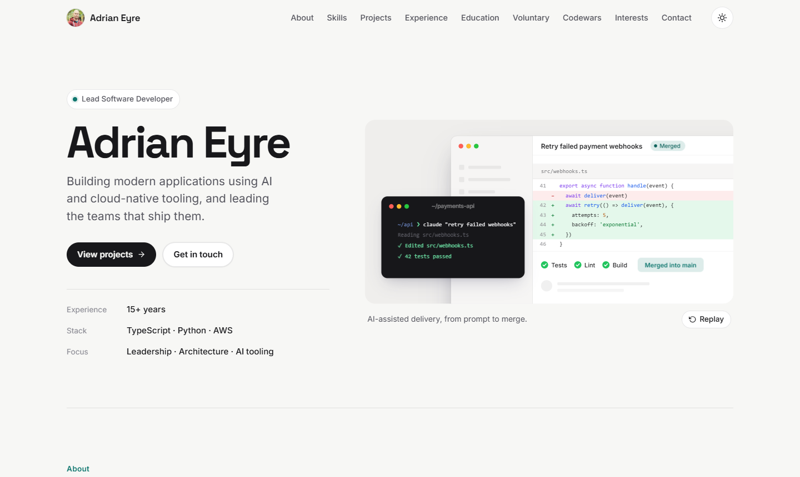
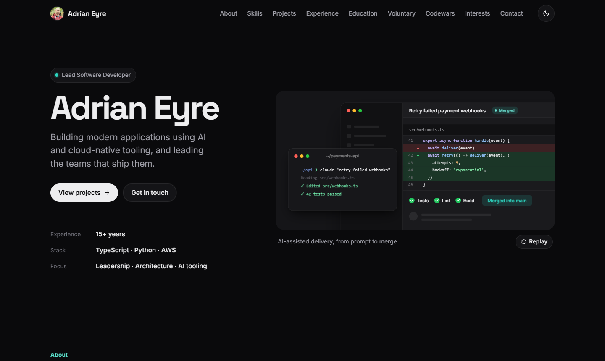
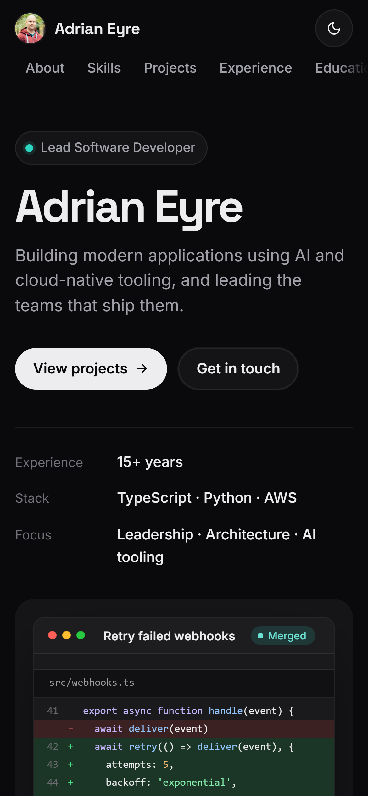
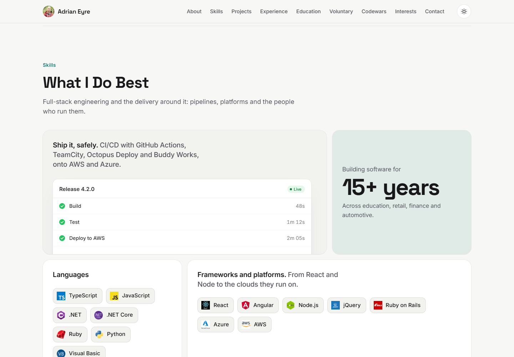
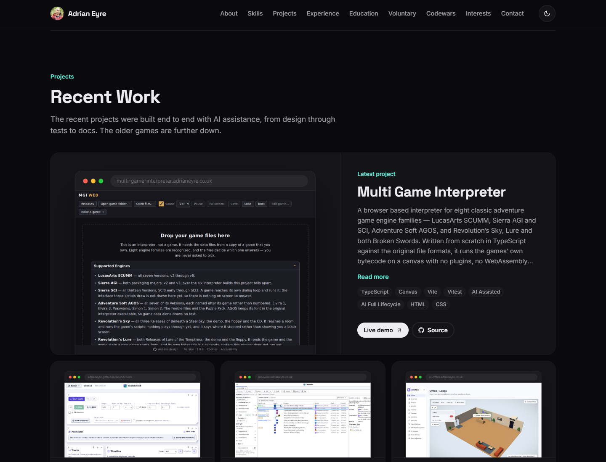
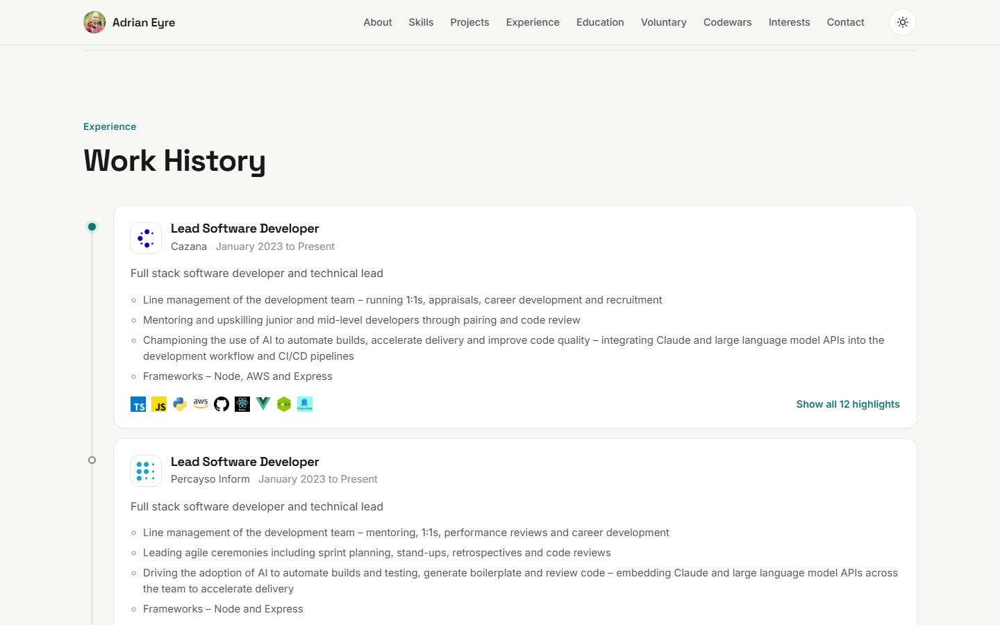

<div align="center">

# Adrian Eyre — Portfolio

**The source for [adrianeyre.co.uk](https://adrianeyre.co.uk): a single-page React portfolio of projects, skills and experience.**

[](https://github.com/adrianeyre/portfolio/actions/workflows/release.yml)
[](CHANGELOG.md)
[](LICENSE)

React 19 · TypeScript · Vite · Vitest · Stageshow · GitHub Pages

</div>



## Screenshots

The design is built with the [Stageshow](https://github.com/benjitaylor/skills) skill: a quiet page with a single accent colour, and product illustrations made with its React kit rather than decorative cards.

| Dark theme | Phone |
| --- | --- |
|  |  |

| Skills | Projects |
| --- | --- |
|  |  |



To retake them, start the dev server and run `npm run screenshots` (it uses the Chrome already installed on your machine; set `CHROME_PATH` if it is somewhere unusual, or `SITE_URL` for another address). They are taken with reduced motion on, so each illustration shows its finished frame.

---

## Quick start

**Prerequisites:** [Node.js](https://nodejs.org/) 26 or newer (see `.nvmrc`) and npm.

```shell
git clone https://github.com/adrianeyre/portfolio.git
cd portfolio
nvm use        # optional: switches to the Node version in .nvmrc
npm install
npm run dev
```

The site will be at **http://localhost:5173**, and changes reload as you save.

## Scripts

| Command              | What it does                                          |
| -------------------- | ----------------------------------------------------- |
| `npm run dev`        | Starts the Vite dev server with hot reload            |
| `npm run build`      | Type-checks, then builds the production site to `dist/` |
| `npm run preview`    | Serves the production build locally                   |
| `npm test`           | Runs the test suite once with Vitest                  |
| `npm run test:watch` | Runs the tests in watch mode                          |
| `npm run typecheck`  | Type-checks the code without emitting files           |
| `npm run screenshots` | Retakes the README screenshots from a running dev server |

## Project structure

```
src/
├── data/        # JSON content: projects, experience, skills, education…
├── sections/    # Page sections (About, Skills, Projects, Experience, Contact…)
├── layout/      # Header, hero and footer
├── demos/       # The Stageshow illustrations: hero, release pipeline, project shots
├── stageshow/   # The Stageshow React kit, copied from benjitaylor/skills (MIT)
├── components/  # Shared UI: modals, photo grid, theme toggle, cookie consent
├── hooks/       # Scroll spy and reduced-motion helpers
├── theme/       # Light/dark theme provider
└── test/        # Smoke, accessibility (axe-core) and deployment tests
public/          # Static assets, images, fonts and the CNAME for the custom domain
docs/screenshots # The README screenshots (see `npm run screenshots`)
```

## Illustrations

The animated hero, the release pipeline in Skills and the framed project screenshots are built with the [Stageshow](https://github.com/benjitaylor/skills) kit in `src/stageshow`. [`src/stageshow/README.md`](src/stageshow/README.md) explains where it came from and how to preview and film a scene on its own. Each illustration plays once as it scrolls into view and shows its finished frame to visitors who prefer reduced motion.

## Editing content

All site content lives in **`src/data/*.json`**, so you can update most of it without touching a component. For example, to add a project, add an entry to `src/data/projects.json` and put its screenshot in `public/images/projects/`:

```json
{
  "title": "My Project",
  "body": "A short description of what it does.",
  "image": {
    "filename": "/images/projects/my-project.png",
    "link": "https://github.com/adrianeyre/my-project"
  },
  "tags": [{ "label": "TypeScript" }, { "label": "React" }]
}
```

## Releases & deployment

Releases and deployment are automated with [GitHub Actions](.github/workflows/release.yml):

- **Every pull request** to `master` is type-checked, tested and built.
- **Every merge** to `master` runs [semantic-release](https://github.com/semantic-release/semantic-release). It uses the [Conventional Commit](https://www.conventionalcommits.org/) messages to bump the version and update the [CHANGELOG](CHANGELOG.md), then publishes the site to **GitHub Pages**.

Write commit messages as `feat: …`, `fix: …`, `docs: …` and so on, so that each release gets the right version bump.

## License

[MIT](LICENSE) © Adrian Eyre
